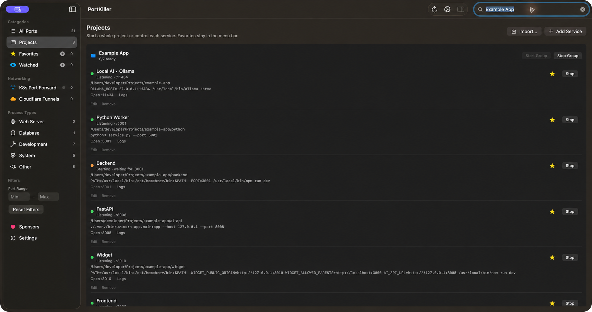
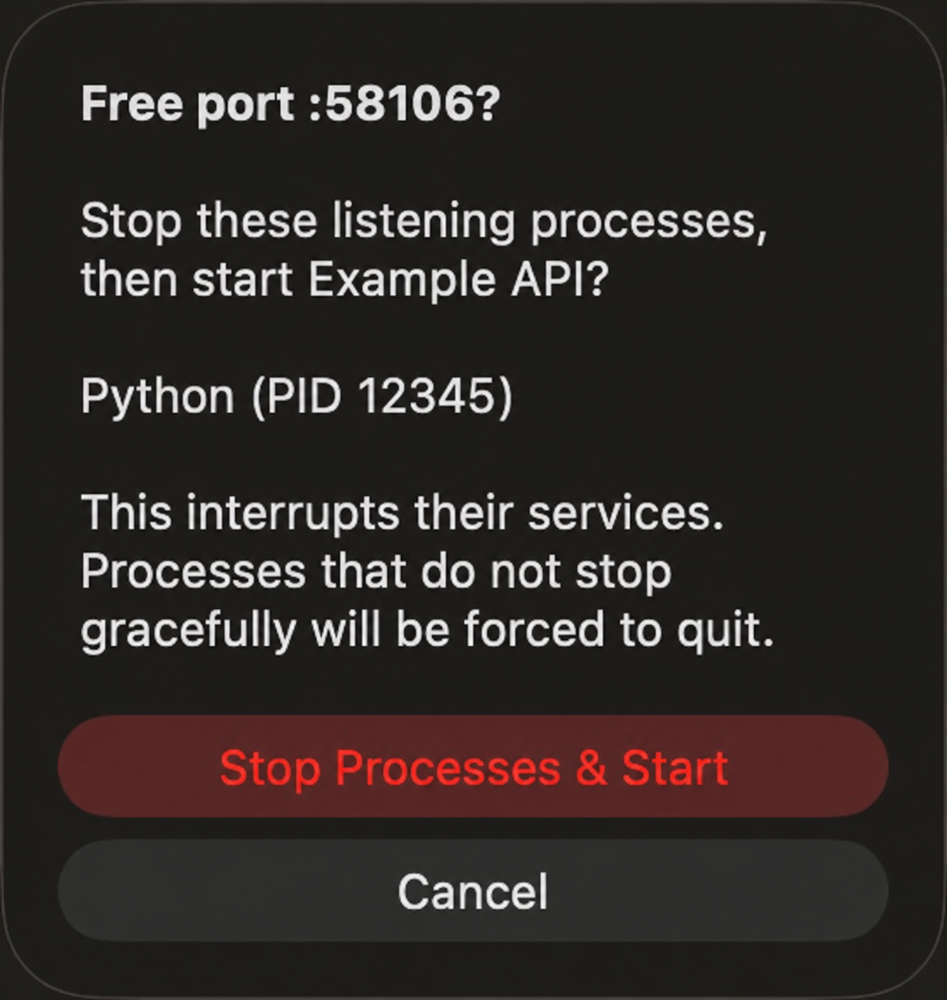

# PortKiller Projects

Start and stop your development projects from the macOS menu bar. Save favorite
services, group them by project, inspect logs and recover occupied ports explicitly.

A macOS fork of [PortKiller](https://github.com/productdevbook/port-killer),
maintained by [gabritorres](https://github.com/gabritorres). MIT licensed.

## Download for Mac

**[Download the DMG](https://github.com/gabritorres/port-killer/releases/download/projects-v0.1.0/PortKiller-Projects-0.1.0-macos-universal.dmg)**
· [ZIP](https://github.com/gabritorres/port-killer/releases/download/projects-v0.1.0/PortKiller-Projects-0.1.0-macos-universal.zip)
· [Release notes](https://github.com/gabritorres/port-killer/releases/tag/projects-v0.1.0)
· [SHA-256 checksums](https://github.com/gabritorres/port-killer/releases/download/projects-v0.1.0/SHA256SUMS.txt)

**Version 0.1.0 beta · macOS 15+ · Apple Silicon and Intel (universal).**
Drag the app from the DMG into Applications, then open it. The Intel binary is
cross-compiled; runtime verification was performed on Apple Silicon.

This beta is **ad-hoc signed and not notarized by Apple**. macOS may block its first
launch. Read the [installation guide](INSTALL.md), including Apple's per-app
security guidance, before deciding whether to open it. Updates are manual.

## Projects in one place



- Save a folder, foreground start command and optional TCP port for each service.
- Favorite projects stay in the menu bar even when stopped.
- Start or stop an entire project, or control services individually.
- Set launch order and leave optional services out of group startup.
- See starting/listening status, ready counts, service URLs and private logs.
- Import local JSON launch recipes without replacing unrelated projects.
- Share generated temporary variables between linked services without saving values.

No personal projects or machine-specific launch recipes ship with the app. New
installations start empty; Node, Python and other project dependencies remain
on your machine. See [the project guide](PROJECTS.md) for setup and behavior.

## Restart and recover a port

Closed TCP connections in TIME_WAIT no longer cause a false busy-port warning.
If a real process still listens on the required port, **Free :port & Start…** lists
its name and PID and asks before stopping it. Ownership is checked again before
sending signals. Ordinary Start/Stop and group actions preserve external services.

<p align="center">
  
</p>

These are real application captures, anonymized with OpenAI image editing.
Project names, paths and the displayed example PID were replaced for privacy;
they are not bundled projects. Interface states and controls come from the app.

## Existing PortKiller tools

Port scanning, favorites, watched ports, Kubernetes port forwarding and Cloudflare
tunnels remain available. Closing the main window leaves the menu bar app running;
quitting stops services it launched. **Launch at Login** is optional and starts
PortKiller, while projects are started on demand.

This fork's public download is for macOS. The original project's
[Windows and Linux versions](https://github.com/productdevbook/port-killer#installation)
remain available upstream and do not include this project's macOS additions.
The upstream Homebrew cask installs the original app, not this fork.

## Build and contribute

```sh
git clone https://github.com/gabritorres/port-killer.git
cd port-killer/platforms/macos
./scripts/build-dev-app.sh
```

The development app has separate preferences from the public download. To produce
the universal public DMG, ZIP and checksums:

```sh
./scripts/build-projects-release.sh 0.1.0
```

Full Xcode is needed for the complete Swift Testing suite. Executable smoke checks
also run with Command Line Tools; see [verification instructions](PROJECTS.md),
[contributing guidance](CONTRIBUTING.md) and the [fork changelog](CHANGELOG.md).
The manual **Projects Release** GitHub Actions workflow can build and publish
future versions without upstream release credentials.

## Credits and license

Based on [productdevbook/port-killer](https://github.com/productdevbook/port-killer).
The original copyright and [MIT license](LICENSE) are preserved. Bundled third-party
licenses are included in the app's Resources folder. No affiliation with the
original maintainer is implied by this fork's releases.
